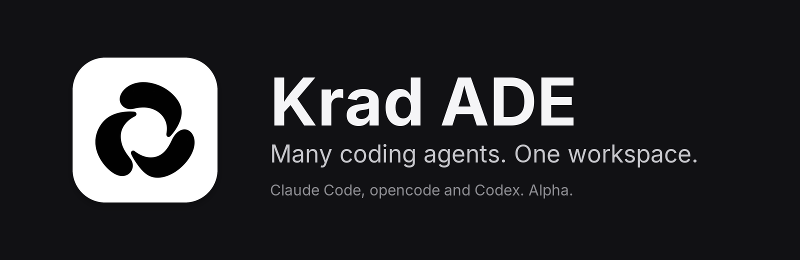
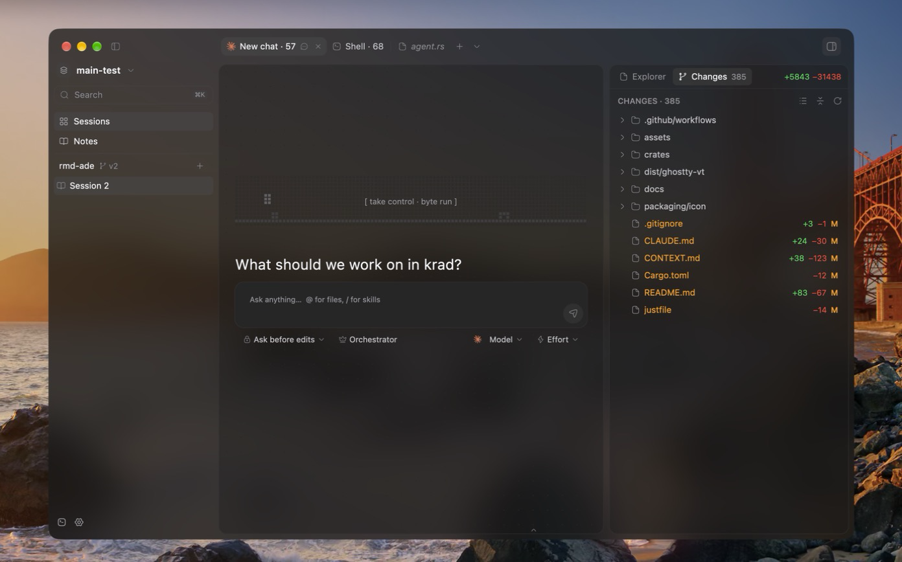
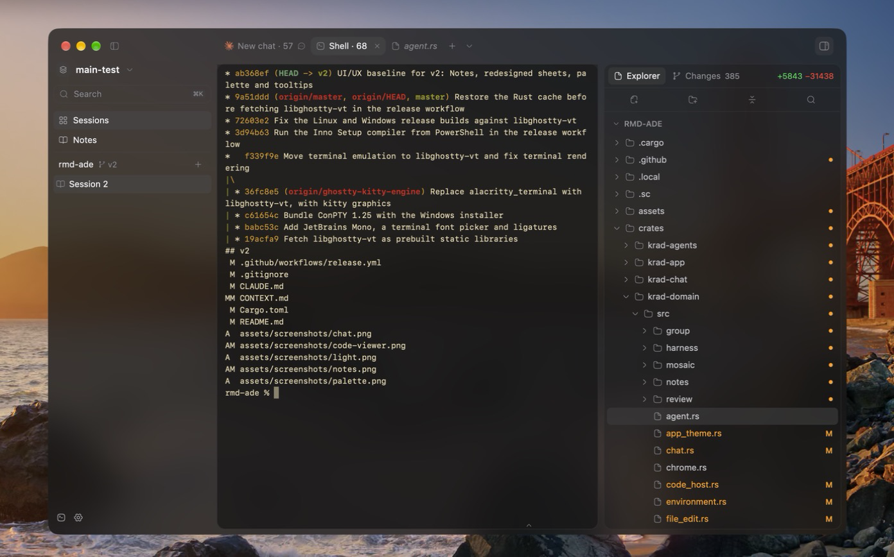
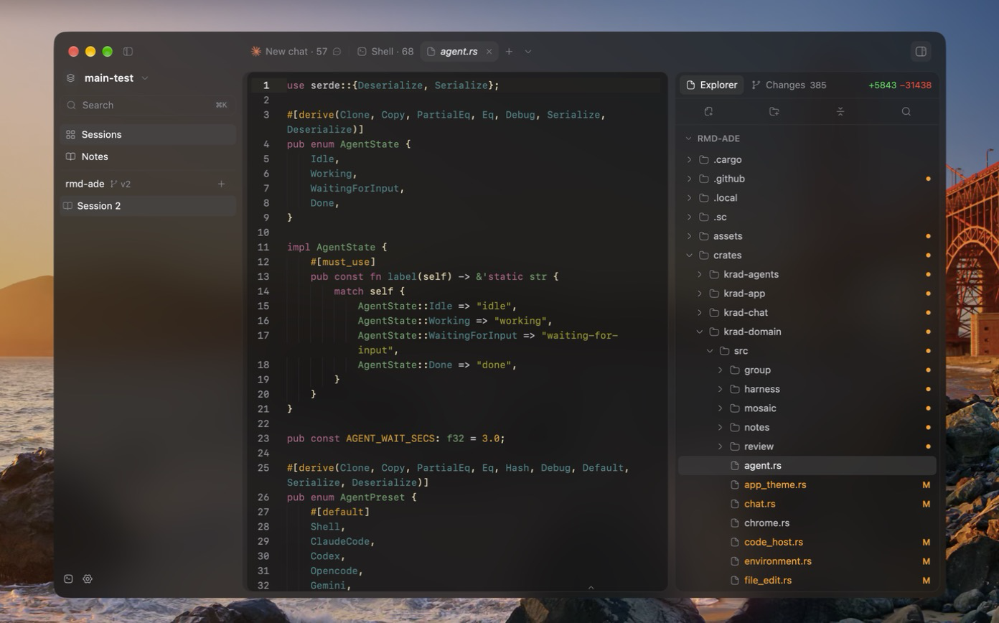
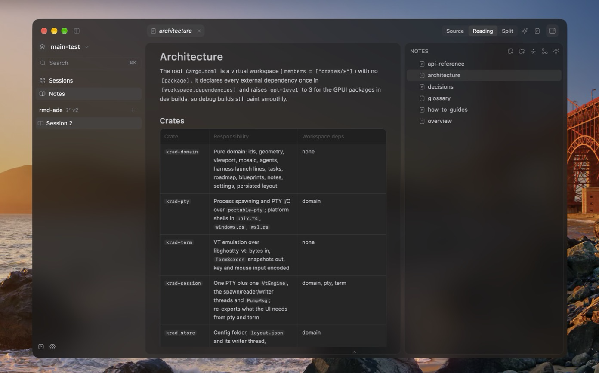
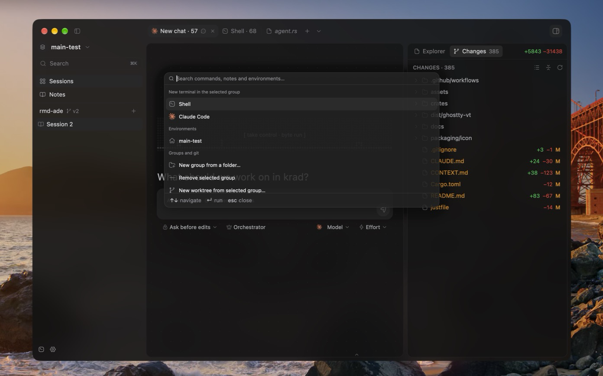
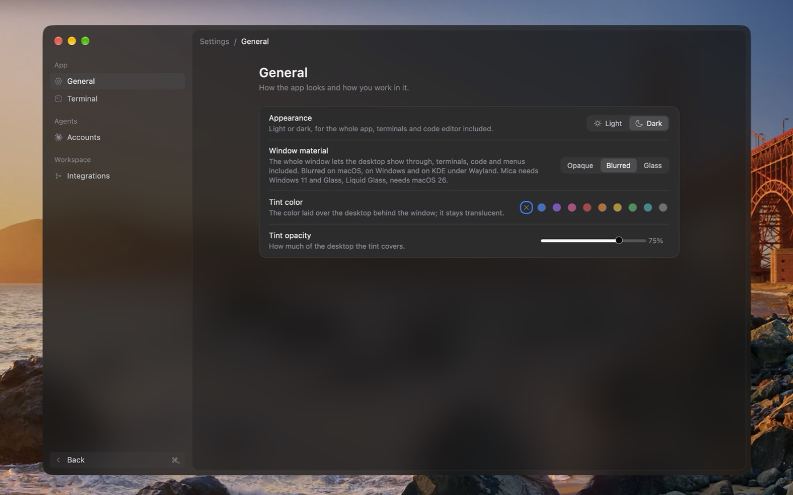
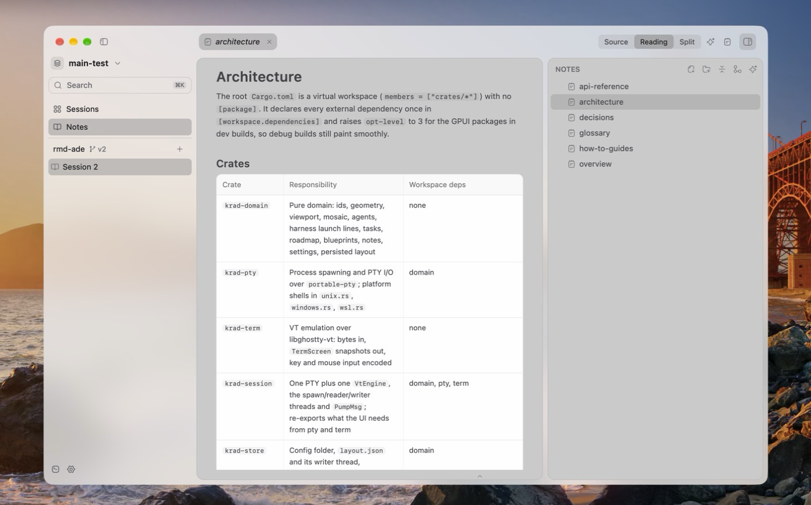
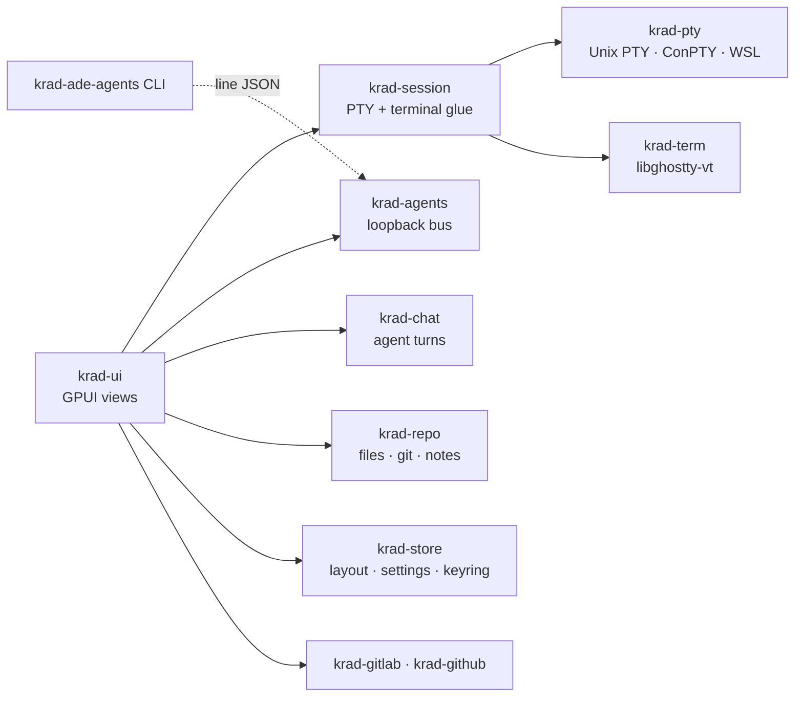

<p align="center">
  
</p>

<p align="center">
  <strong>An agentic development environment for people who run more than one coding agent at a time.</strong>
</p>

<p align="center">
  <em>Alpha: works with Claude Code, opencode v2 and Codex.</em>
</p>

<p align="center">
  <a href="#license"></a>
  
  
  
</p>

<p align="center">
  <a href="#features">Features</a> ·
  <a href="#getting-started">Getting started</a> ·
  <a href="#how-it-works">How it works</a> ·
  <a href="#architecture">Architecture</a> ·
  <a href="#contributing">Contributing</a>
</p>

---

Krad ADE is a native desktop app to work with coding agents. Every group of yours is a folder of a
repository, and every group holds sessions: lines of work that open on a chat with Claude Code,
opencode or Codex and grow with shells, more agents and files as tabs. Split a session into panes,
turn its chat into an
orchestrator that starts and directs other agents, and keep notes, reviews and the repository's
changes one click away.

It is written in Rust on [GPUI](https://www.gpui.rs/), with real terminal emulation from
[libghostty-vt](https://github.com/ghostty-org/ghostty), ConPTY on Windows, WSL support and no
Electron.

<p align="center">
  
</p>

## Features

### Sessions that start as a chat

- **Chat first.** A new session opens on a chat: pick the model and the effort, mention files with
  `@`, call skills with `/` and answer its permission requests and questions in place.
- **Three harnesses, one picker.** The model picker groups the models of every installed harness,
  Claude Code, opencode v2 and Codex, behind one tab each, with search and the keyboard; opencode's
  are split into OpenCode Go, OpenCode Zen, your other providers and free models. Picking a model
  before the first message decides which harness runs the chat.
- **Orchestrator mode.** One switch in the composer turns a chat into the session's orchestrator:
  it splits the work, starts workers in terminals of the group, types instructions into them and
  checks what they did.
- **As a chat or a terminal.** Terminal view turns a chat's tab into the harness's own TUI on the
  same conversation (`claude --resume`, `opencode --session`, `codex resume`), and back. Shells open
  in tabs beside the chat.
- **Each harness through its own protocol.** Claude Code runs as one live stream-json process per
  chat, opencode through a private `opencode serve` the app starts and talks to over HTTP and server
  events, and Codex through one `codex app-server` per chat over JSON-RPC. Permission modes map to
  each harness's own approvals, sandboxes and plan mode, and usage limits show where the harness
  reports them.
- **Panes and snap layouts.** Drag a tab to a half or a quarter of the view, or onto a template at
  the top, to split the session into up to four panes; drag their dividers to resize them.
- **Live agent state.** Hooks report whether each agent is working, waiting for you or done, and
  the sidebar shows it next to each session.
- **Restored as you left them.** Environments, groups, sessions, panes, scrollback and
  conversations come back when the app reopens.

<p align="center">
  
</p>

### Your repository beside the agents

- **Groups and worktrees.** A group binds a session to a folder; start a git worktree for an agent
  that should not step on the others.
- **Explorer and changes.** The side panel holds the file tree and the group's git changes with
  added and removed lines; files open as tabs with syntax highlighting, and a changes tab shows the
  diff.
- **Review.** Merge requests from GitLab and pull requests from GitHub, with commits, changes,
  discussions, approvals and pipelines.
- **Utilities panel.** An activity log and system terminals along the foot of the window, which
  any tab can be dropped on.

<p align="center">
  
</p>

### Notes

A vault of Markdown notes inside the repository, written by hand in source, reading or split mode,
with folders, attachments, links, backlinks, tags, a graph, LaTeX, Mermaid and callouts. An agent
can generate documentation into it from the folders you pick.

<p align="center">
  
</p>

### Made to be lived in

- **Command palette.** Commands, environments, notes and the lines inside them from the keyboard.
- **Sessions of your own.** Rename environments and groups, and give each session a colour and an
  icon of its own from its right-click menu.
- **Translucent window.** Opaque, blurred or Liquid Glass on macOS (Mica on Windows), with a tint
  colour and opacity you pick.
- **Light and dark**, and a small game of its own on every empty chat.

<p align="center">
  
  
</p>

<p align="center">
  
</p>

## Getting started

### Requirements

- The Rust toolchain pinned in [`rust-toolchain.toml`](rust-toolchain.toml) (a nightly; `rustup`
  installs it on the first build).
- **Linux:** the usual GPUI dependencies (Vulkan drivers, `libxkbcommon`, Wayland or X11
  development headers).
- **Windows:** the `x86_64-pc-windows-gnu` toolchain with a MinGW GCC on `PATH`.
- `git` on `PATH` for groups, worktrees and the file tree.
- At least one harness installed as usual and signed in:
  - [Claude Code](https://docs.anthropic.com/en/docs/claude-code) (`claude` on `PATH`)
  - [opencode](https://opencode.ai) v2 (`opencode` on `PATH`; 1.x is not supported)
  - [Codex](https://github.com/openai/codex) (`codex` on `PATH`, `codex login`)

### Build and run

```bash
git clone https://github.com/joordih/krad-ade.git
cd krad-ade
cargo run --release -p krad-app --bin krad-ade
```

The release build places `krad-ade-agents` next to `krad-ade`; the app puts its own folder on the
`PATH` of every terminal it opens, which is how agents find the bus CLI.

### Packages

| Platform | What | Where |
|---|---|---|
| Windows | Inno Setup installer with the app icon | [`installer/krad-ade.iss`](installer/krad-ade.iss) |
| Linux | Desktop entry and icons from 16 to 1024 px | [`packaging/linux`](packaging/linux), [`packaging/icon/png`](packaging/icon/png) |
| macOS | `.icns` icon | [`packaging/macos`](packaging/macos) |

All icons come from one source, `packaging/icon/krad-ade-logo.png`:
`python3 packaging/icon/generate_icons.py` regenerates the PNG, ICO and ICNS files and the banner
above.

### Keyboard

Windows and Linux use <kbd>Ctrl</kbd>+<kbd>Shift</kbd> so shells keep their control keys; macOS
uses <kbd>Cmd</kbd>.

| Action | Windows / Linux | macOS |
|---|---|---|
| Command palette | <kbd>Ctrl</kbd>+<kbd>Shift</kbd>+<kbd>P</kbd> | <kbd>Cmd</kbd>+<kbd>K</kbd> |
| New chat tab | <kbd>Ctrl</kbd>+<kbd>Shift</kbd>+<kbd>T</kbd> | <kbd>Cmd</kbd>+<kbd>T</kbd> |
| New shell beside the focused tab | <kbd>Ctrl</kbd>+<kbd>Shift</kbd>+<kbd>D</kbd> | <kbd>Cmd</kbd>+<kbd>D</kbd> |
| Search the terminal | <kbd>Ctrl</kbd>+<kbd>Shift</kbd>+<kbd>F</kbd> | <kbd>Cmd</kbd>+<kbd>F</kbd> |
| Side panel | <kbd>Ctrl</kbd>+<kbd>Alt</kbd>+<kbd>B</kbd> | <kbd>Cmd</kbd>+<kbd>Alt</kbd>+<kbd>B</kbd> |
| Utilities panel | <kbd>Ctrl</kbd>+<kbd>Shift</kbd>+<kbd>E</kbd> | <kbd>Cmd</kbd>+<kbd>Shift</kbd>+<kbd>E</kbd> |
| Settings | <kbd>Ctrl</kbd>+<kbd>,</kbd> | <kbd>Cmd</kbd>+<kbd>,</kbd> |

### Configuration

Settings live in the app's config folder: `$XDG_CONFIG_HOME/krad-ade`, else
`~/.config/krad-ade`, else `%APPDATA%\krad-ade`. Logins are kept in the system keyring.

| Integration | Configured through |
|---|---|
| GitLab | Host and OAuth application id in Settings › Integrations |
| GitHub | Device sign-in in Settings › Integrations |

## How it works



A chat drives its harness without a terminal and renders its stream natively: Claude Code's
stream-json, opencode's server events or Codex's app-server notifications become the same chat
events. A terminal is a PTY
paired with an emulator: a dedicated thread pumps its output through a bounded channel, the
emulator turns bytes into snapshots and the UI paints only what is on screen. Agents report their
state through their vendor's hooks and reach each other, and the orchestrator, through a
token-protected loopback endpoint.

## Architecture

The workspace is split by responsibility, and the dependency rules are strict: the domain has no
UI, terminal or I/O types, and GPUI only reaches `krad-ui` and `krad-app`.

| Crate | Responsibility |
|---|---|
| `krad-domain` | Ids, environments, groups, sessions and panes, agents, notes, settings and the persisted layout |
| `krad-pty` | Process spawning and PTY I/O (Unix PTY, Windows ConPTY, WSL) |
| `krad-term` | Terminal emulation: bytes in, renderable snapshots out |
| `krad-session` | One PTY plus one terminal, with their threads and events |
| `krad-store` | The app's files on disk and the system keyring |
| `krad-repo` | A group's folder: listing, file index, git status, worktrees and the notes vault |
| `krad-chat` | Headless agent turns and the live chat process |
| `krad-agents` | The agents bus, its protocol and the `krad-ade-agents` CLI |
| `krad-gitlab` | GitLab REST API v4 and OAuth |
| `krad-github` | GitHub REST and GraphQL APIs and device sign-in |
| `krad-ui` | Every view, element, action, keymap and theme |
| `krad-app` | The `krad-ade` and `krad-ade-agents` binaries |

The vocabulary the code uses is in [`CONTEXT.md`](CONTEXT.md).

## Contributing

Issues and pull requests are welcome. Before opening one:

```bash
just format-check        # rustfmt with the pinned nightly
just lint                # clippy, pedantic, no unwrap / expect / panic
cargo test --workspace
```

Please read [`CLAUDE.md`](CLAUDE.md), the engineering guide every change follows: crate
boundaries, error handling, naming, tests and the verification steps above.

## License

Licensed under either of

- Apache License, Version 2.0 ([LICENSE-APACHE](LICENSE-APACHE))
- MIT license ([LICENSE-MIT](LICENSE-MIT))

at your option. Icons from [Hugeicons](https://hugeicons.com/) (MIT) and
[Simple Icons](https://simpleicons.org/) (CC0); see [`assets/icons`](assets/icons). Fonts are
[Inter](https://rsms.me/inter/) and [JetBrains Mono](https://www.jetbrains.com/lp/mono/), both under
the SIL Open Font License; on macOS the app uses the system's own SF fonts instead.

Unless you explicitly state otherwise, any contribution intentionally submitted for inclusion in
the work by you, as defined in the Apache-2.0 license, shall be dual licensed as above, without any
additional terms or conditions.
