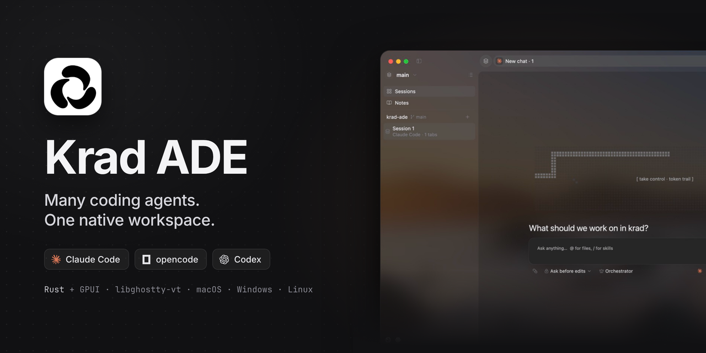
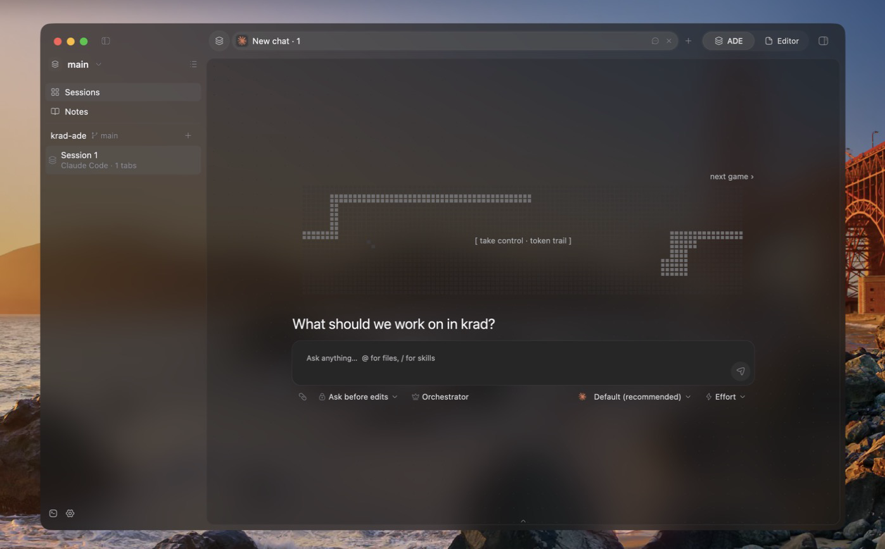
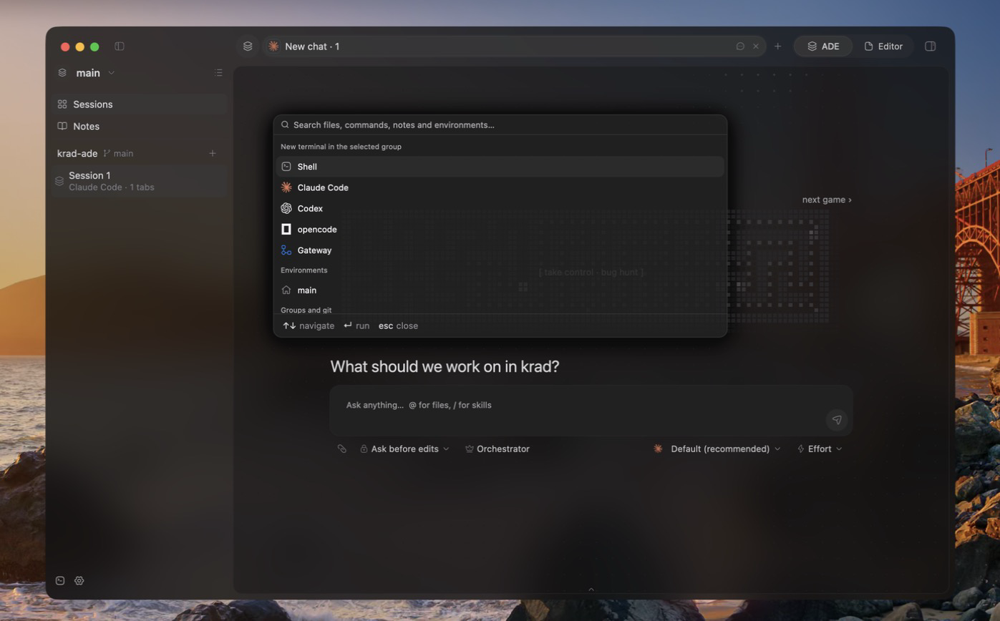
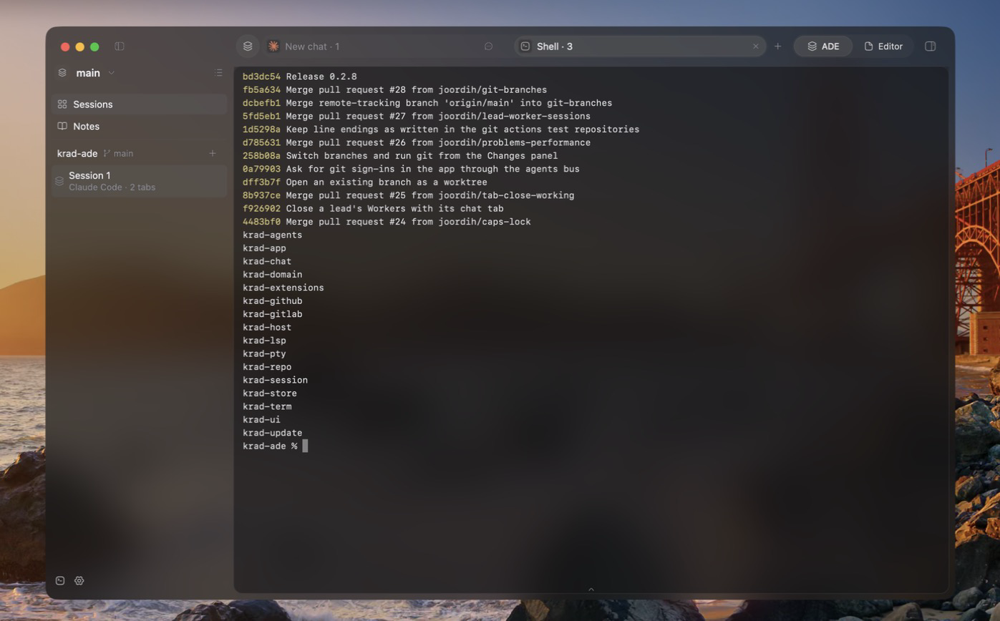
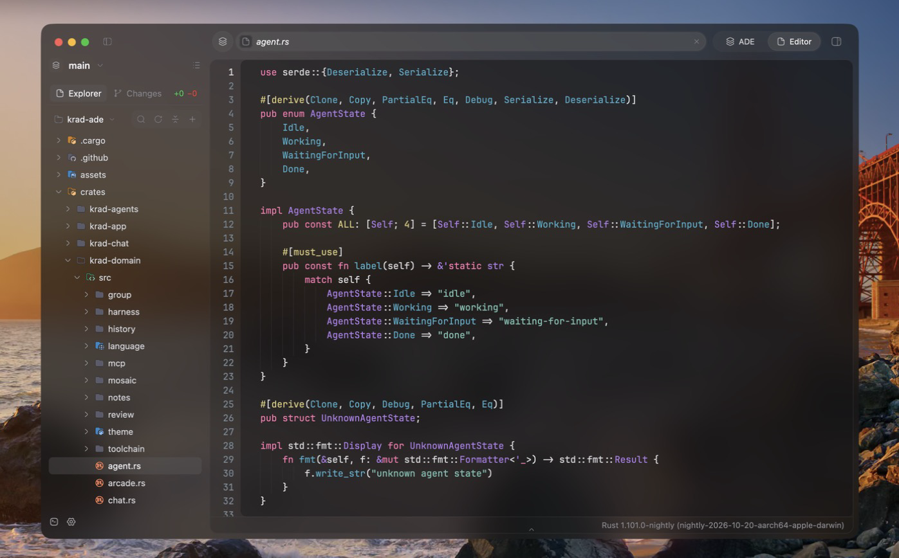
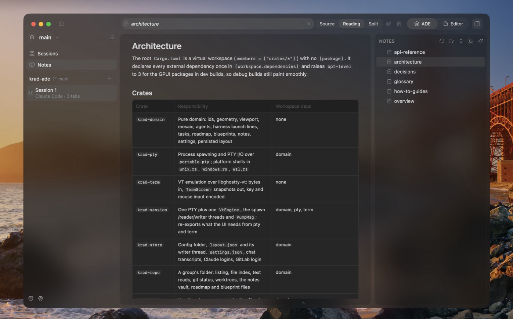
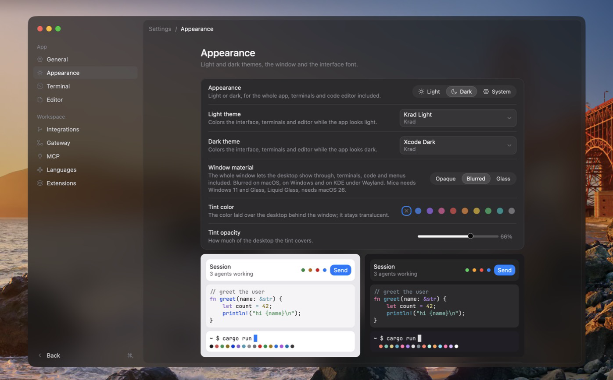
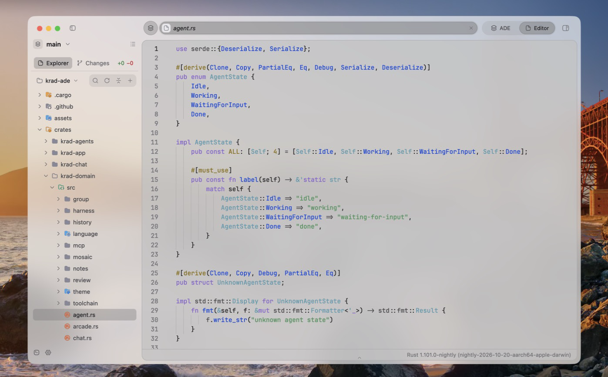
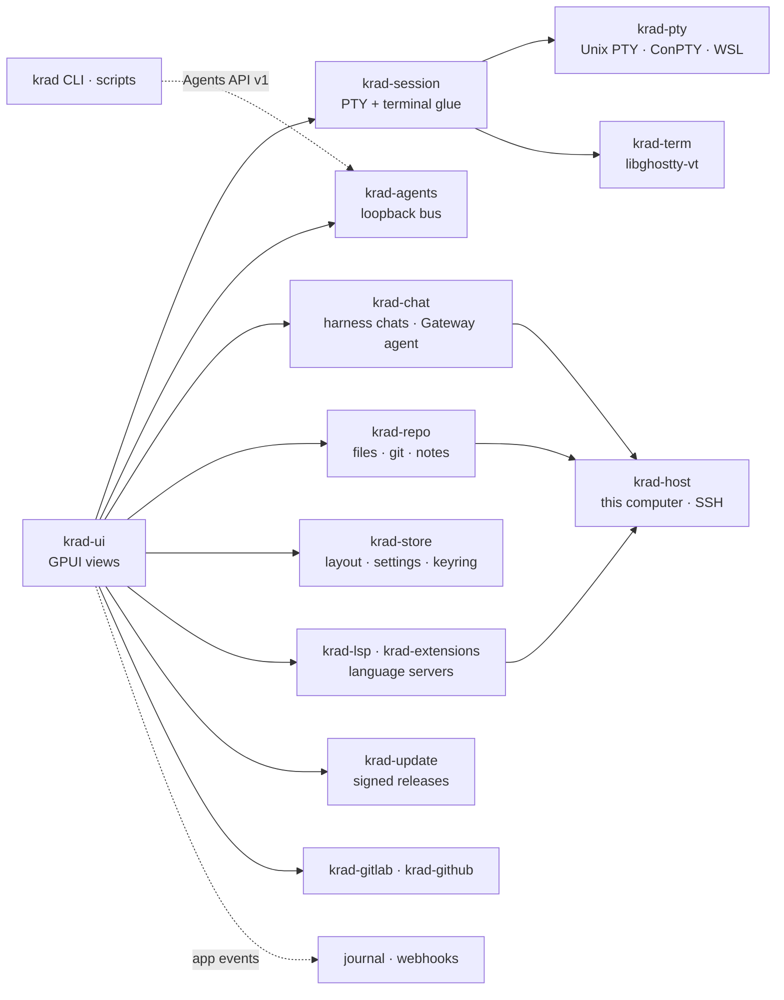

<p align="center">
  
</p>

<p align="center">
  <strong>An agentic development environment for people who run more than one coding agent at a time.</strong>
</p>

<p align="center">
  <em>Alpha: works with Claude Code, opencode v2, Codex and any Gateway such as CLIProxyAPI.</em>
</p>

<p align="center">
  <a href="#license"></a>
  
  
  
</p>

<p align="center">
  <a href="https://getkrad.dev">Website</a> ·
  <a href="https://getkrad.dev/docs">Docs</a> ·
  <a href="#features">Features</a> ·
  <a href="API.md">Agents API</a> ·
  <a href="#getting-started">Getting started</a> ·
  <a href="#how-it-works">How it works</a> ·
  <a href="#architecture">Architecture</a> ·
  <a href="#contributing">Contributing</a>
</p>

---

Krad ADE is a native desktop app to work with coding agents. Every group of yours is a folder of a
repository, and every group holds sessions: lines of work that open on a chat with Claude Code,
opencode, Codex or your own Gateway, and grow with shells, more agents and files as tabs. Turn a
chat into the lead that starts and directs other agents, switch to Editor mode to work on the code
yourself, and keep notes, reviews and the repository's changes one click away, on this computer or
on a machine you reach over SSH. Kraddies, workers with a name and a memory of their own, run your
automations while you do something else.

It is written in Rust on [GPUI](https://www.gpui.rs/), with real terminal emulation from
[libghostty-vt](https://github.com/ghostty-org/ghostty), ConPTY on Windows, WSL support and no
Electron.

<p align="center">
  
</p>

## Features

### Sessions that start as a chat

- **Chat first.** A new session opens on a chat: pick the model and the effort, mention files and
  images with `@` or by pasting them, call skills with `/`, mention a Kraddie with `$`, and answer
  permission requests, questions and plans in place of the composer. Messages sent while the agent
  works wait in a queue.
- **Readable models, one effort slider.** Model ids show as names (Claude Opus, 1M context), and a
  slider sets the effort from Minimal to Ultra, snapped to what the model allows. Each chat keeps its
  choice, and the last one becomes the harness's default.
- **Every harness in one picker.** Claude Code, opencode v2 and Codex each behind their own tab,
  with search and the keyboard. Picking a model before the first message decides which harness
  runs the chat.
- **Your own Gateway.** Point the app at a server such as CLIProxyAPI that offers your accounts'
  models behind one Anthropic- and OpenAI-compatible address, and chat with them through the app's
  own agent: files, search, shell, web fetch and search, plans, checklists, subagents and the tools
  of your MCP servers, under the same permission modes.
- **Lead and Workers.** One switch in the composer turns a chat into the session's lead: it splits
  the work, starts Workers as sessions of their own, follows each one from a live card in its chat
  and reads their work when they finish.
- **Rewind with the files.** Cut a chat back to one of your messages, edit it and let the agent
  answer again; choose "Conversation and files" to bring the files back to that point too, with the
  list of what is restored or deleted, and undo the restore if you change your mind. The steps the
  agent tracks show above the composer as it goes.
- **Search every chat.** Find a message across Claude Code, Codex, opencode, Gateway and ACP chats
  from the command palette, then reopen the chat, fork it from that message, or export the
  exchange or the whole chat as a note.
- **Variants.** Give one task to two to four agents and models, each in a worktree of its own, and
  compare their diffs, tests, cost, tokens and time side by side before you pick the winner; the
  others are discarded with their worktrees.
- **Templates and issues.** Session templates in `.krad-ade/templates` set the harness, model,
  worktree, MCP servers, name and first prompt; start one from an open GitHub or GitLab issue and
  its title, body, number and branch fill the variables.
- **As a chat or a terminal.** Terminal view turns a chat's tab into the harness's own TUI on the
  same conversation, and back. Shells open in tabs beside the chat.
- **Panes and snap layouts.** Drag a tab to a half or a quarter of the view, or onto a template at
  the top, to split the session into up to four panes.
- **Live agent state.** Hooks report whether each agent is working, waiting for you or done, and
  the sidebar shows it next to each session.
- **Long chats stay fast.** The thread builds only the rows on screen and remeasures only the ones
  that changed, and each Markdown block keeps its view instead of being parsed again.
- **Restored as you left them.** Environments, groups, sessions, panes, scrollback and
  conversations come back when the app reopens.

<p align="center">
  
</p>

<p align="center">
  
</p>

### Kraddies

Kraddies are named Workers that live between sessions: each has a harness, model and effort, a
repository it works in and a pixel look you paint yourself.

- **A design studio.** Paint up to eight layers on a 24 by 24 canvas with brush, eraser, fill,
  line, rectangle and ellipse, a look per mood, a body style and an animation.
- **A compass and keepsakes.** The compass is a Markdown file of its standing instructions;
  keepsakes are short lines it carries into each run, up to 200.
- **Memory that stays where it belongs.** When a Kraddie's chat ends or rests, the app writes a
  digest of what was learned. A chat reads its own Kraddie's memory, the Kraddies it was allowed to
  read (one way: they do not read it back) and those you mention with `$`, and agents search it
  through the `memory_search` and `memory_read` tools.
- **Chats of its own.** Open a chat that belongs to a Kraddie, in the folder it works in or the
  one each chat picks.
- **Rounds.** After a quiet spell it can look around and leave suggestions, under a brief that
  tells it not to edit, commit or open anything: you decide.
- **A history.** Every run is in its logbook, and a six-month trail shows its days by runs, lines
  changed, tokens or cost.

### Automations

An automation is a routine a Kraddie runs as a Worker session, reporting through the attention
queue.

- **Blueprints.** Start from a gallery of sixteen, such as a morning risk sweep, a docs refresh, a
  red build responder or a Friday recap.
- **Triggers.** A schedule; an app event (an agent finished or waits, git changed, a worktree came or
  went, variants finished); a GitHub or GitLab pull or merge request opening, or its CI failing or
  passing; by hand, or from the `krad` CLI.
- **Session options.** Run right here or in a worktree of its own, begin anew or pick up where it
  stopped, in a group, with its own harness, model, effort and permission mode.
- **Catch-up.** A scheduled run missed while the app was closed runs once at start when it falls
  inside the window you choose, from 15 minutes to 24 hours, or is let go.

### Attention and usage

- **Notifications.** While the window is in the background, the system tells you when an agent asks
  for permission, needs you, runs into an error or finishes; a permission can be approved or denied
  from the notification itself.
- **Inbox.** One panel lists the agents waiting for you and the recent history, filtered by
  finished, asks, permissions and errors, and a shortcut jumps to the next waiting agent.
- **Rules and quiet hours.** Choose per kind whether it notifies, plays a sound (macOS) and counts on
  the badge; quiet hours and muted sessions silence notifications and sounds but keep the count.
- **Badge.** The Dock icon shows how many agents wait on macOS; on Windows and Linux the window asks
  for attention in the taskbar.
- **Usage bar.** Along the foot of the window, each harness's subscription use per plan window
  (5 hours, weekly and the rest) with when it resets, warning near the limit.
- **Spending.** What each session, Worker and group has spent, with a budget per group that warns
  once at the share you choose and again when it is exceeded.
- **Harness health.** The app checks that each harness is installed, on `PATH`, recent enough and
  signed in, and the first time none is ready it shows how to fix it, with the command to copy.

### An editor when you want one

- **Editor mode.** One switch moves open files into the work area, the agent's chat into the side
  panel and the terminals into the utilities panel; nothing closes on the way.
- **Language servers.** Diagnostics with problem lenses, completion, hover, go to definition,
  references, rename, formatting and quick fixes. The app installs each server from Mason's
  registry after asking, the first time a file of its language opens, and analyses the code with
  the toolchain you pick per project folder (a virtual environment, a Node.js version, a JDK).
- **Web projects.** HTML, CSS and SCSS, and Svelte language servers; highlighting for `.svelte`,
  `.astro` and `.vue` files; and new-file templates for React, Vue, Svelte and Astro components in
  projects with a `package.json`.
- **Project search and replace.** Text or regular expressions across the group's folder from the
  side panel, with every change shown before it is applied to one file or all of them.
- **Project tasks.** The `package.json` scripts, Cargo commands, `justfile` recipes and `Makefile`
  targets of the folder run from the command palette in a new terminal.
- **Extensions.** Add languages, toolchains and server runtimes as plain manifests from a git
  address or a local folder.
- **Explorer and changes.** The file tree and the group's git changes, with staging, history,
  stashes and a branch switcher; a minimap and quick open for large files.

<p align="center">
  
</p>

### Your repository beside the agents

- **Groups and worktrees.** A group binds sessions to a folder; start a git worktree for an agent
  that should not step on the others.
- **Remote hosts.** An environment can live on a machine reached over SSH: its folders, terminals,
  chats, agents and language servers all run there.
- **Review.** Merge requests from GitLab and pull requests from GitHub, with commits, changes,
  discussions, approvals and pipelines, and diffs highlighted as code. A failed CI job has "Fix with
  agent", which hands its log to an agent.
- **A session's changes.** See what a session changed since it started and accept or revert each
  file or block; discard a whole folder's changes back to the last commit. Comments you leave on the
  changes reach the session's chat as one review.
- **Utilities panel.** An activity log and system terminals along the foot of the window, which
  any tab can be dropped on.

### Agents API, events and webhooks

- **Agents API v1.** The bus the agents talk through is a versioned protocol: one line of JSON per
  request over a token-protected loopback endpoint, stable error codes, and a subscription that
  streams every agent's state as it changes. Inside the app's terminals the `krad` CLI finds it on
  its own; other programs find it through an owner-only `api.json` in the config folder. The full
  reference is in [`API.md`](API.md).
- **App events.** Agents starting, waiting and finishing, worktrees, sessions, git changes,
  reviews, CI results, merge requests and variants are recorded per group in a rotating journal.
- **Webhooks.** Settings › Webhooks posts the events you choose to your own address, signed with
  HMAC-SHA256 when you give it a secret, and retries a few times when it fails.

### Notes

A vault of Markdown notes inside the repository, written in source, reading or split mode, with
folders, attachments, links, backlinks, tags, a graph, LaTeX, Mermaid and callouts. An agent can
generate documentation into it from the folders you pick.

<p align="center">
  
</p>

### Made to be lived in

- **Command palette.** Files, commands, environments, notes and the lines inside them from the
  keyboard.
- **Themes.** One theme for light and one for dark, from the app's own and well-known editor
  themes, covering the interface, the terminals and the code at once.
- **Translucent window.** Opaque, blurred or Liquid Glass on macOS (Mica on Windows), with a tint
  colour and opacity you pick.
- **Sessions of your own.** Give each session a colour and an icon from its right-click menu.
- **Updates in place.** Release builds find, verify and install new versions themselves.
- **An arcade** of small games on every empty chat, until the conversation starts.

<p align="center">
  
</p>

<p align="center">
  
</p>

## Getting started

### Download

Every [release](https://github.com/joordih/krad-ade/releases) has a signed and notarized DMG for
Apple Silicon and Intel Macs, an installer for Windows and a `tar.gz` for Linux on x86-64 and
ARM64. Installed builds update themselves from later releases, whose manifest is signed with
minisign.

### Requirements

- The Rust toolchain pinned in [`rust-toolchain.toml`](rust-toolchain.toml) (a nightly; `rustup`
  installs it on the first build).
- [`just`](https://github.com/casey/just) and the [GitHub CLI](https://cli.github.com/): the
  prebuilt libghostty-vt libraries are fetched with `just ghostty-libs` before the first build.
- **Linux:** the usual GPUI dependencies (Vulkan drivers, the development headers of fontconfig,
  freetype, `libxkbcommon`, Wayland and X11/xcb).
- **Windows:** the `x86_64-pc-windows-gnu` toolchain with a MinGW GCC on `PATH` (MSYS2 UCRT64 with
  `pkgconf`); `just conpty` fetches the ConPTY DLL.
- `git` on `PATH` for groups, worktrees and the file tree.
- At least one harness installed as usual and signed in:
  - [Claude Code](https://docs.anthropic.com/en/docs/claude-code) (`claude` on `PATH`)
  - [opencode](https://opencode.ai) v2 (`opencode` on `PATH`; 1.x is not supported)
  - [Codex](https://github.com/openai/codex) (`codex` on `PATH`, `codex login`)
  - or a Gateway such as [CLIProxyAPI](https://github.com/router-for-me/CLIProxyAPI), set in
    Settings › Gateway

### Build and run

```bash
git clone https://github.com/joordih/krad-ade.git
cd krad-ade
just ghostty-libs
cargo run --release -p krad-app --bin krad-ade
```

The release build places the `krad` CLI and its `krad-ade-agents` alias next to `krad-ade`; the app
puts its own folder on the `PATH` of every terminal it opens, which is how agents find the bus CLI.
`krad help` lists its commands (agents, sessions, worktrees, files, changes, Kraddies, automations,
variants), their `--json` output and exit codes; [`API.md`](API.md) documents the protocol behind
them, the Agents API v1.

### Packages

| Platform | What | Where |
|---|---|---|
| Windows | Inno Setup installer with the app icon | [`installer/krad-ade.iss`](installer/krad-ade.iss) |
| Linux | Desktop entry and icons from 16 to 1024 px | [`packaging/linux`](packaging/linux), [`packaging/icon/png`](packaging/icon/png) |
| macOS | `Info.plist` and `.icns` icon of `Krad ADE.app` | [`packaging/macos`](packaging/macos) |
| All | Install marker and public key of in-app updates | [`packaging/update`](packaging/update) |

All icons come from one source, `packaging/icon/krad-ade-logo.png`:
`python3 packaging/icon/generate_icons.py` regenerates the PNG, ICO and ICNS files and the banner
above.

### Keyboard

Windows and Linux use <kbd>Ctrl</kbd>+<kbd>Shift</kbd> so shells keep their control keys; macOS
uses <kbd>Cmd</kbd>.

| Action | Windows / Linux | macOS |
|---|---|---|
| Command palette | <kbd>Ctrl</kbd>+<kbd>Shift</kbd>+<kbd>P</kbd> | <kbd>Cmd</kbd>+<kbd>K</kbd> |
| New chat tab | <kbd>Ctrl</kbd>+<kbd>Shift</kbd>+<kbd>T</kbd> | <kbd>Cmd</kbd>+<kbd>T</kbd> |
| New agent | <kbd>Ctrl</kbd>+<kbd>Alt</kbd>+<kbd>N</kbd> | <kbd>Cmd</kbd>+<kbd>Alt</kbd>+<kbd>N</kbd> |
| New shell beside the focused tab | <kbd>Ctrl</kbd>+<kbd>Shift</kbd>+<kbd>D</kbd> | <kbd>Cmd</kbd>+<kbd>D</kbd> |
| ADE and Editor mode | <kbd>Ctrl</kbd>+<kbd>Alt</kbd>+<kbd>E</kbd> | <kbd>Cmd</kbd>+<kbd>Alt</kbd>+<kbd>E</kbd> |
| Quick open | <kbd>Ctrl</kbd>+<kbd>Shift</kbd>+<kbd>N</kbd> | <kbd>Cmd</kbd>+<kbd>Shift</kbd>+<kbd>O</kbd> |
| Find in files | <kbd>Ctrl</kbd>+<kbd>Alt</kbd>+<kbd>F</kbd> | <kbd>Cmd</kbd>+<kbd>Shift</kbd>+<kbd>F</kbd> |
| Next waiting agent | <kbd>Ctrl</kbd>+<kbd>Shift</kbd>+<kbd>J</kbd> | <kbd>Cmd</kbd>+<kbd>Shift</kbd>+<kbd>J</kbd> |
| Attention inbox | <kbd>Ctrl</kbd>+<kbd>Alt</kbd>+<kbd>A</kbd> | <kbd>Cmd</kbd>+<kbd>Alt</kbd>+<kbd>A</kbd> |
| Sidebar | <kbd>Ctrl</kbd>+<kbd>Shift</kbd>+<kbd>B</kbd> | <kbd>Cmd</kbd>+<kbd>Ctrl</kbd>+<kbd>S</kbd> |
| Go to definition | <kbd>Ctrl</kbd>+<kbd>B</kbd> | <kbd>Cmd</kbd>+<kbd>B</kbd> |
| Side panel | <kbd>Ctrl</kbd>+<kbd>Alt</kbd>+<kbd>B</kbd> | <kbd>Cmd</kbd>+<kbd>Alt</kbd>+<kbd>B</kbd> |
| Utilities panel | <kbd>Ctrl</kbd>+<kbd>Shift</kbd>+<kbd>E</kbd> | <kbd>Cmd</kbd>+<kbd>Shift</kbd>+<kbd>E</kbd> |
| Settings | <kbd>Ctrl</kbd>+<kbd>,</kbd> | <kbd>Cmd</kbd>+<kbd>,</kbd> |

### Configuration

Settings live in the app's config folder: `$XDG_CONFIG_HOME/krad-ade`, else
`~/.config/krad-ade`, else `%APPDATA%\krad-ade`. Logins and keys are kept in the system keyring.

| Integration | Configured through |
|---|---|
| GitLab | Host and OAuth application id in Settings › Integrations |
| GitHub | Device sign-in in Settings › Integrations |
| Gateway | Address, key and models in Settings › Gateway |
| MCP servers | Settings › MCP, or a project's `.mcp.json` you trust once per folder |
| Language servers | Settings › Languages and Settings › Extensions |
| Harnesses | Their checks and fixes in Settings › Harnesses; ACP agents in Settings › ACP agents |
| Notifications | Rules, sounds, badge, actions and quiet hours in Settings › Notifications |
| Usage and spending | The usage bar, its warning and the budget per group in Settings › General |
| Webhooks | Address, events and secret in Settings › Webhooks |
| Agents API | "Let other programs find the agents API" in Settings › General, on by default |
| Kraddies and automations | The Kraddies and Automations views; kept as files in the config folder |
| Session templates | JSON files in the repository's `.krad-ade/templates` |

App events are kept in the config folder's `events/`, and `api.json` there names the Agents API's
endpoint while the app runs.

## How it works



A chat drives its harness without a terminal and renders its stream natively: Claude Code's
stream-json, opencode's server events, Codex's app-server notifications or the Gateway agent's own
loop become the same chat events. A terminal is a PTY paired with an emulator: a dedicated thread
pumps its output through a bounded channel, the emulator turns bytes into snapshots and the UI
paints only what is on screen. Files, commands and language servers go through a host link, so the
same code works on this computer and over SSH. Agents report their state through their vendor's
hooks and reach each other, and the lead, through a token-protected loopback endpoint that speaks
the [Agents API](API.md). Changes of the app's own state become app events, written to each group's
journal and posted to the webhooks that chose them.

## Architecture

The workspace is split by responsibility, and the dependency rules are strict: the domain has no
UI, terminal or I/O types, and GPUI only reaches `krad-ui` and `krad-app`.

| Crate | Responsibility |
|---|---|
| `krad-domain` | Ids, environments, hosts, groups, sessions and panes, agents, Kraddies, automations, memory, variants, app events, notes, settings and the persisted layout |
| `krad-pty` | Process spawning and PTY I/O (Unix PTY, Windows ConPTY, WSL) |
| `krad-term` | Terminal emulation: bytes in, renderable snapshots out |
| `krad-session` | One PTY plus one terminal, with their threads and events |
| `krad-store` | The app's files on disk (layout, settings, Kraddies, chat digests, the event journal) and the system keyring |
| `krad-repo` | A group's folder: listing, file index, git status, worktrees and the notes vault |
| `krad-chat` | Each harness's live chat, and the Gateway agent with its tools and MCP client |
| `krad-host` | This computer or an SSH host: files over SFTP, commands, terminals and port forwards |
| `krad-lsp` | Language server client over stdio |
| `krad-extensions` | Language, toolchain and server runtime manifests and the package registry |
| `krad-extension-id` | The extension id and its rule, published to crates.io |
| `krad-extension-api` | The protocol between the app and extension programs, published to crates.io |
| `krad-update` | Signed release manifests, verified downloads and in-place installs |
| `krad-agents` | The agents bus, the Agents API v1, its discovery file, the agent event feed and the `krad` CLI |
| `krad-gitlab` | GitLab REST API v4 and OAuth |
| `krad-github` | GitHub REST and GraphQL APIs and device sign-in |
| `krad-ui` | Every view, element, action, keymap and theme, and the webhook sender |
| `krad-app` | The `krad-ade` binary and the `krad` CLI with its `krad-ade-agents` alias |

The vocabulary the code uses is in [`CONTEXT.md`](CONTEXT.md).

## Contributing

Issues and pull requests are welcome. Before opening one:

```bash
just format-check        # rustfmt with the pinned nightly
just lint                # clippy, pedantic, no unwrap / expect / panic
cargo test --workspace
```

Please read [`CLAUDE.md`](CLAUDE.md), the engineering guide every change follows: crate
boundaries, error handling, naming, tests and the verification steps above.

## License

Licensed under either of

- Apache License, Version 2.0 ([LICENSE-APACHE](LICENSE-APACHE))
- MIT license ([LICENSE-MIT](LICENSE-MIT))

at your option. Icons from [Hugeicons](https://hugeicons.com/) (MIT) and
[Simple Icons](https://simpleicons.org/) (CC0); see [`assets/icons`](assets/icons). File tree icons
from [Charmed Icons](https://github.com/littensy/charmed-icons) (MIT), through the
[aaa-lt fork](https://github.com/aaa-lt/charmed-icons); see [`assets/file-icons`](assets/file-icons). Fonts are
[Inter](https://rsms.me/inter/) and [JetBrains Mono](https://www.jetbrains.com/lp/mono/), both under
the SIL Open Font License; on macOS the app uses the system's own SF fonts instead.

Unless you explicitly state otherwise, any contribution intentionally submitted for inclusion in
the work by you, as defined in the Apache-2.0 license, shall be dual licensed as above, without any
additional terms or conditions.
